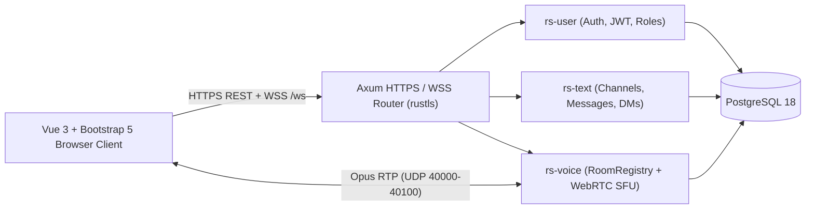

# rustspeak

Self-hosted text, direct message, and WebRTC voice communication app built with Rust (Axum, SQLx, `webrtc`) and Vue 3.

## Architecture



## Ports and Firewall / NAT Requirements

| Protocol | Default Port(s) | Purpose |
| --- | --- | --- |
| TCP | `8443` (or `443` in prod) | HTTPS REST API, static SPA, and WSS WebSocket gateway |
| UDP | `40000-40100` (`ICE_UDP_PORT_MIN`..`ICE_UDP_PORT_MAX`) | WebRTC SFU ICE/DTLS/SRTP Opus audio media |

- For LAN/localhost testing, default `ICE_BIND_IP=127.0.0.1` (or your LAN IP) works without STUN.
- Behind NAT or across the internet, open/forward both the TCP HTTPS port and the entire UDP media range (`40000-40100/udp`), set `ICE_BIND_IP` to the reachable host IP, and optionally set `STUN_URL`.

## Local Development Setup

### 1. Start PostgreSQL 18

```sh
docker compose up -d postgres
```

### 2. Generate Self-Signed Development TLS Certificates

Run the OpenSSL script to generate a self-signed certificate for `localhost` and `127.0.0.1`:

```sh
./scripts/dev-cert.sh
```

This creates `certs/localhost.pem` and `certs/localhost-key.pem`. Accept the self-signed certificate in your browser on first visit (or trust `certs/localhost.pem` in your OS/browser store).

### 3. Build Frontend and Run Server

```sh
cp .env.example .env
cd web && npm install && npm run build && cd ..
cargo run -p rs-server
```

For frontend hot-reload during development, run `cd web && npm run dev` (proxies `/api` and `/ws` to `https://127.0.0.1:8443`).
To run without TLS in local development only, pass `--insecure-dev` or set `INSECURE_DEV=true`.

## Full-Stack Docker Profile

Generate dev certs (or mount your own), set `JWT_SECRET`, and start Postgres + `rs-server`:

```sh
./scripts/dev-cert.sh
docker compose --profile full up -d --build
```

## End-to-End Smoke Checklist

1. Open `https://localhost:8443` and register User A (automatically assigned `owner` role).
2. Open a second browser/incognito window and register User B (assigned `member` role).
3. Verify User A sees the **Admin** nav link and User B does not.
4. Send messages in `#general` from both browsers; verify realtime delivery and scrollback history.
5. Open a Direct Message between User A and User B; verify online status indicator and private realtime delivery.
6. Join the `General` voice channel in both browsers, allow microphone access, and verify two-way Opus audio, mute/deafen, and leave controls.
7. Run the automated test suite:
   ```sh
   cargo nextest run --workspace --test-threads 1 --fail-fast
   ```
