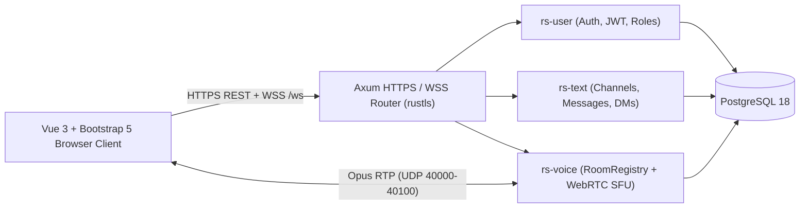

# rustspeak

Self-hosted text, direct message, and WebRTC voice communication app built with Rust (Axum, SQLx, `webrtc`) and Vue 3.

## Architecture



## Ports and Firewall / NAT Requirements

| Protocol | Default Port(s) | Purpose |
| --- | --- | --- |
| TCP | `80`, `443` | Caddy reverse proxy: automatic Let's Encrypt HTTPS/WSS signaling and static SPA |
| UDP | `40000-40100` (`ICE_UDP_PORT_MIN`..`ICE_UDP_PORT_MAX`) | WebRTC SFU DTLS-SRTP Opus audio media (`app` container directly) |

- Signaling (REST + `/ws`) uses **TLS** at Caddy; WebRTC media uses **DTLS-SRTP** directly over UDP (`40000-40100`).
- On a VPS with only a public IP (no purchased domain), set `PUBLIC_HOST=<YOUR_VPS_IP>.sslip.io` in `.env`. Caddy automatically obtains a browser-trusted Let's Encrypt certificate so friends never need to trust a self-signed certificate.
- `STUN_URL=stun:stun.l.google.com:19302` is enabled by default and shared with browser clients via `GET /api/voice/config`.

## Quick Start (Docker Compose + Caddy)

```sh
./setup.sh
```

- Local development: `PUBLIC_HOST=:80` serves `http://localhost` (a browser Secure Context for microphone access).
- VPS production: set `PUBLIC_HOST=<YOUR_VPS_IP>.sslip.io` (or your domain) and a strong `JWT_SECRET` in `.env`, open TCP `80`/`443` and UDP `40000-40100`, then run `./setup.sh`.
- Database bootstrap with mock users/channels: `./scripts/dev-db-wrapper.sh`.

## Local Cargo Development (Without Docker App)

### 1. Start PostgreSQL 18

```sh
docker compose up -d postgres
```

### 2. Generate Self-Signed Development TLS Certificates

Run the OpenSSL script to generate a self-signed certificate for `localhost` and `127.0.0.1`:

```sh
./scripts/dev-cert.sh
```

This creates `certs/localhost.pem` and `certs/localhost-key.pem`. Accept the self-signed certificate in your browser on first visit (or trust `certs/localhost.pem` in your OS/browser store).

### 3. Build Frontend and Run Server

```sh
cp .env.example .env
cd web && npm install && npm run build && cd ..
cargo run -p rs-server
```

For frontend hot-reload during development, run `cd web && npm run dev` (proxies `/api` and `/ws` to `https://127.0.0.1:8443`).
To run without TLS in local development only, pass `--insecure-dev` or set `INSECURE_DEV=true`.
